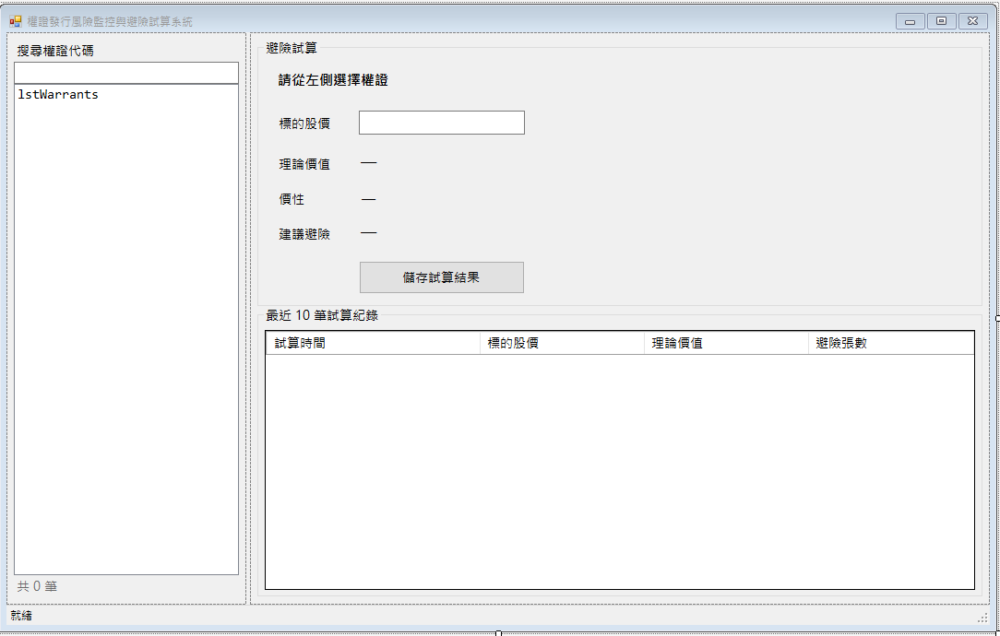
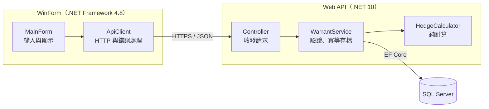
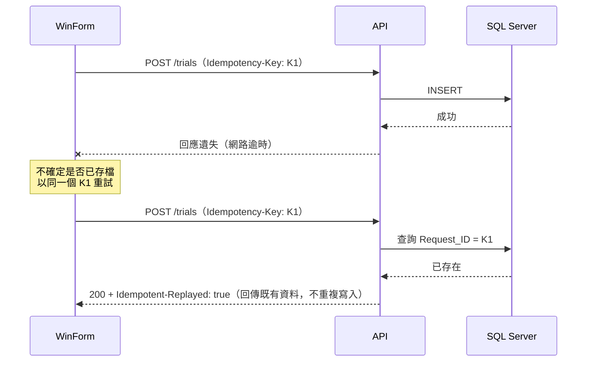

# 權證發行風險監控與避險試算系統

> 全端開發工程師實作測驗：題目一

交易員輸入標的股價後，系統即時試算權證的**理論價值**與 **Delta 避險張數**，並可將試算結果存檔、查詢歷史紀錄。




## 目錄

- [功能總覽](#功能總覽)
- [技術棧](#技術棧)
- [專案結構](#專案結構)
- [執行步驟](#執行步驟)
- [架構設計與理由](#架構設計與理由)
- [開發重點的實作方式](#開發重點的實作方式)
- [API 規格](#api-規格)
- [資料庫設計](#資料庫設計)
- [設計假設](#設計假設)
- [測試](#測試)
- [已知限制與未來改進](#已知限制與未來改進)

---

## 功能總覽

| 區塊 | 功能 |
|---|---|
| 權證導覽列 | 左側列出 800 筆權證，輸入代碼關鍵字即時篩選 |
| 動態試算面板 | 輸入標的股價後即時顯示理論價值、價性（價內／價平／價外）、建議避險張數與方向 |
| 儲存試算結果 | 寫入 `Warrant_Trial_Log`，右下角顯示 Toast 提示；具冪等性，不會重複存檔 |
| 歷史明細區 | 底部表格列出該權證最近 10 筆存檔紀錄，存檔後自動更新 |

---

## 技術棧

| 層級 | 技術 | 選擇理由 |
|---|---|---|
| 前端 | C# WinForm（.NET Framework 4.8） | 題目指定；前後端同為 C#，降低維護成本 |
| 後端 | ASP.NET Core Web API（.NET 10） | 目前的 LTS 版本，支援至 2028 年 11 月（.NET 8 將於 2026 年 11 月結束支援） |
| 資料存取 | Entity Framework Core 10 | 參數化查詢防止 SQL Injection；以 LINQ 撰寫查詢 |
| 資料庫 | SQL Server 2016 以上 | 題目指定；`AT TIME ZONE` 需 2016 以上 |
| JSON（前端） | Newtonsoft.Json | .NET Framework 未內建；可設定小數直接解析為 `decimal` |
| 單元測試 | xUnit | .NET 主流測試框架 |

> 題目所寫的「.NET Core」自 .NET 5 起更名為「.NET」，.NET 10 即為 .NET Core 路線的最新版本。

---

## 專案結構

```
WarrantHedge/
├─ Database/
│  ├─ 01_schema.sql              建立資料庫與資料表、索引、約束
│  └─ 02_seed.sql                產生測試資料（800 筆權證、2,400 筆試算紀錄）
├─ WarrantHedge.API/             後端 Web API（.NET 10）
│  ├─ Controllers/               接收請求、回傳結果，不含業務邏輯
│  ├─ Services/
│  │  ├─ HedgeCalculator.cs      核心計算（純函式，不依賴資料庫）
│  │  └─ WarrantService.cs       輸入驗證、查詢、冪等存檔
│  ├─ Data/                      EF Core DbContext 與欄位對應
│  ├─ Models/                    Entity 與 DTO
│  ├─ Infrastructure/            全域例外處理（ProblemDetails）
│  └─ WarrantHedge.API.http      API 測試案例（12 個）
├─ WarrantHedge.API.Tests/       HedgeCalculator 單元測試（xUnit，21 個）
├─ WarrantHedge.WinForm/         前端 WinForm（.NET Framework 4.8）
│  ├─ Services/ApiClient.cs      集中管理 HTTP 呼叫與錯誤處理
│  ├─ Models/                    對應 API 的 JSON 格式
│  ├─ MainForm.cs                主畫面
│  └─ ToastForm.cs               提示訊息（自製，WinForm 無內建）
└─ WarrantHedge.slnx
```

---

## 執行步驟

### 環境需求

| 項目 | 版本 |
|---|---|
| Visual Studio | 2026（需安裝「ASP.NET 與網頁程式開發」、「.NET 桌面開發」工作負載） |
| .NET SDK | 10.0 |
| .NET Framework | 4.8（Windows 10 / 11 已內建） |
| SQL Server | 2016 以上（Express、LocalDB、Developer 版皆可） |

### 1. 建立資料庫

在 SSMS 或 Visual Studio 中**依序**執行（整份執行，不要反白部分內容）：

1. `Database/01_schema.sql`：建立 `WarrantHedgeDB` 資料庫與資料表
2. `Database/02_seed.sql`：產生測試資料

執行成功後，`02_seed.sql` 最後會顯示驗證結果：CALL 400 筆、PUT 400 筆、試算紀錄 2,400 筆。

> 兩份 Script 皆可重複執行。重新執行 `02_seed.sql` 會清除所有試算紀錄並重新產生。

### 2. 設定連線字串

編輯 `WarrantHedge.API/appsettings.json`：

```json
"ConnectionStrings": {
  "WarrantHedgeDb": "Server=localhost;Database=WarrantHedgeDB;Trusted_Connection=True;TrustServerCertificate=True;"
}
```

若使用 SQL Server Express，將 `Server=localhost` 改為 `Server=localhost\SQLEXPRESS`。

### 3. 設定 WinForm 的 API 網址

編輯 `WarrantHedge.WinForm/App.config`，將 port 改為 `WarrantHedge.API/Properties/launchSettings.json` 中 **https** profile 的 port：

```xml
<appSettings>
  <add key="ApiBaseUrl" value="https://localhost:7001/" />
  <add key="ApiTimeoutSeconds" value="60" />
</appSettings>
```

### 4. 啟動

1. 以 Visual Studio 開啟 `WarrantHedge.slnx`
2. 方案總管 → 在方案上按右鍵 → **設定啟動專案** → **多個啟動專案**
3. `WarrantHedge.API` 與 `WarrantHedge.WinForm` 皆設為「啟動」，API 排在前面
4. 按 `F5`

若出現 SSL 憑證錯誤，執行 `dotnet dev-certs https --trust` 信任本機開發憑證。

### 5. 測試 API（不需 WinForm）

- **Swagger UI**：瀏覽器開啟 `https://localhost:{port}/swagger`
- **.http 檔**：在 Visual Studio 開啟 `WarrantHedge.API/WarrantHedge.API.http`，點擊各請求上方的「傳送要求」

### 6. 執行單元測試

Visual Studio：**測試** → **測試總管** → **全部執行**；或在方案根目錄執行：

```
dotnet test
```

---

## 架構設計與理由



### 為什麼 WinForm 不直接連資料庫

| 考量 | 說明 |
|---|---|
| 計算邏輯只有一份 | 題目要求核心計算放在 C# API。若 WinForm 也自行計算，兩邊邏輯可能不一致 |
| 不信任 Client | 存檔時 API 只接收「股價」，理論價值與避險張數一律在 Server 端重算，前端無法竄改計算結果 |
| 資安 | 資料庫連線字串只存在 Server 端，不會隨 WinForm 執行檔散布到使用者電腦 |
| 擴充性 | 日後新增 Web 前端（如 Vue.js）可直接共用同一組 API |

### 為什麼後端要分層

| 層級 | 職責 | 好處 |
|---|---|---|
| Controller | 只處理 HTTP（路由、Header、狀態碼） | 保持精簡，容易閱讀 |
| WarrantService | 輸入驗證、資料存取、冪等處理 | 業務流程集中在一處 |
| HedgeCalculator | 只做計算，不碰資料庫、沒有狀態 | **可以直接寫單元測試**，不需要準備資料庫 |

### 錯誤處理

所有錯誤由 `GlobalExceptionHandler` 統一轉換為 [RFC 9457 ProblemDetails](https://www.rfc-editor.org/rfc/rfc9457) 格式，WinForm 端只需解析一種錯誤格式；未預期的錯誤不會將內部訊息回傳給 Client。

```json
{
  "title": "輸入資料錯誤",
  "status": 400,
  "detail": "標的股價必須大於 0。"
}
```

---

## 開發重點的實作方式

### 1. 金融數值處理精度（Decimal）

`double` 以二進位儲存小數，部分十進位小數無法精確表示（例如 `0.1 + 0.2 = 0.30000000000000004`）。本系統**每一層**都使用十進位型別：

| 層級 | 做法 |
|---|---|
| 資料庫 | 欄位使用 `DECIMAL(18,4)`、`DECIMAL(18,2)` |
| API 計算 | 全程 `decimal`；捨入指定 `MidpointRounding.AwayFromZero` |
| API 驗證 | 股價超過 4 位小數回傳 400，**不自動捨入**，避免存入的值與使用者輸入不同 |
| API 輸入 | 請求使用 `decimal?`，可分辨「未輸入」與「輸入 0」；不使用 `[Range]`（內部以 `double` 比較） |
| JSON 傳輸 | WinForm 設定 `FloatParseHandling.Decimal`，小數直接解析為 `decimal`，不經過 `double` |
| 畫面輸入 | 使用 `decimal.TryParse` 搭配 `CultureInfo.InvariantCulture` |
| 單元測試 | 測試資料使用 `TheoryData<decimal>`；`[InlineData]` 不支援 `decimal`，改用 `double` 會將誤差帶進測試本身 |

**捨入規則的陷阱**：C# 的 `Math.Round` 預設是**銀行家捨入**（四捨六入五成雙），`Math.Round(0.025m, 2)` 會得到 `0.02`；SQL Server 的 `ROUND()` 則是四捨五入，得到 `0.03`。本系統明確指定 `AwayFromZero`，使 C# 與 SQL 的結果一致，並以單元測試驗證。

### 2. API 冪等性

「冪等」指同一個請求執行一次或多次，結果相同。存檔 API 透過 `Idempotency-Key` Header 達成，共有四道防線：

| 防線 | 位置 | 防範情境 |
|---|---|---|
| ① 按鈕停用 | WinForm | 使用者快速連點 |
| ② 存檔前查詢 `Request_ID` | API | 網路重送同一請求 |
| ③ `Request_ID` 唯一索引 | 資料庫 | 兩個相同請求**同時**抵達，②都查不到 |
| ④ 失敗時沿用同一個 Key | WinForm | 逾時後不確定是否已寫入，重試仍安全 |



| 情境 | 回應 |
|---|---|
| 新的 Key | `201 Created` |
| 相同 Key、相同內容 | `200 OK` + Header `Idempotent-Replayed: true`，回傳既有那一筆 |
| 相同 Key、不同內容 | `422`，提示 Client 誤用舊 Key |
| 併發寫入撞到唯一索引 | 捕捉 SQL 錯誤碼 2601 / 2627，改回傳既有資料 |

WinForm 在**每次產生新的試算結果**時建立新的 Key；存檔失敗時保留原 Key 供重試。

### 3. SQL 效能優化（Set-based）

**測試資料以集合運算一次產生，不使用迴圈：**

- 800 筆權證：以 `ROW_NUMBER()` 產生序號，一個 `INSERT ... SELECT` 寫入
- 2,400 筆試算紀錄：`CROSS JOIN` 三種股價情境（履約價 × 0.9 / 1.0 / 1.1），計算邏輯以 `CASE` 在 SQL 中完成，一次寫入
- 數值以固定公式產生（非亂數），每次執行結果一致，便於驗證

**「最近 10 筆」查詢的索引設計：**

```sql
CREATE NONCLUSTERED INDEX IX_Trial_Log_Warrant_Time
    ON dbo.Warrant_Trial_Log (Warrant_ID, Created_Time DESC)
    INCLUDE (Market_Price, Theory_Price, Hedge_Qty);
```

| 設計 | 效果 |
|---|---|
| 索引鍵 `(Warrant_ID, Created_Time DESC)` | 依權證篩選後資料已依時間排序，`TOP 10` 只需讀取 10 筆，不需排序 |
| `INCLUDE` 其餘欄位 | 形成涵蓋索引（Covering Index），不需回到資料表讀取（Key Lookup） |
| 第二排序鍵 `Log_ID DESC` | 同一時間有多筆時，排序結果穩定 |

<!-- TODO：補上執行計畫截圖，證明為 Index Seek

-->

### 4. UI 易用性

| 項目 | 做法 |
|---|---|
| 即時試算 | 停止輸入 300ms 後自動試算（Debounce），避免每打一個字就呼叫 API；按 Enter 立即試算 |
| 避免顯示過時結果 | 有新輸入時以 `CancellationToken` 取消舊請求；歷史紀錄以版本號丟棄過時回應 |
| 輸入與結果一致 | 股價一變更立即清空結果並停用儲存按鈕，不會存到與畫面輸入不符的結果 |
| 即時驗證 | 空白、非數字、≤ 0、超過 4 位小數，直接在輸入框旁顯示紅字 |
| 搜尋 | 於記憶體中篩選 800 筆，不重複呼叫 API；篩選時保留目前選取的權證 |
| Toast 提示 | 不搶輸入框焦點、不出現在工作列，連續觸發時不重疊 |
| 避險方向 | 顯示「買入／賣出 X 張」，紅色為買、綠色為賣（台股慣例） |
| 錯誤處理 | 連線失敗、逾時皆顯示中文訊息並可重試，程式不閃退 |

---

## API 規格

Base URL：`/api/warrants`

| Method | 路徑 | 說明 | 成功 | 錯誤 |
|---|---|---|---|---|
| GET | `/api/warrants?keyword=` | 權證清單（可依代碼篩選） | 200 | |
| GET | `/api/warrants/{id}` | 單一權證 | 200 | 404 |
| POST | `/api/warrants/{id}/calculate` | 試算（不存檔） | 200 | 400、404 |
| POST | `/api/warrants/{id}/trials` | 儲存試算結果，需帶 `Idempotency-Key` | 201 / 200 | 400、404、422 |
| GET | `/api/warrants/{id}/trials?top=10` | 最近 N 筆紀錄（預設 10，上限 50） | 200 | 404 |

**試算請求與回應範例**

```http
POST /api/warrants/030001/calculate
Content-Type: application/json

{ "marketPrice": 100 }
```

```json
{
  "warrantId": "030001",
  "warrantType": "CALL",
  "marketPrice": 100,
  "strikePrice": 57.2500,
  "theoryPrice": 4.275,
  "moneyness": "ITM",
  "delta": 0.8,
  "hedgeQty": 50.96,
  "hedgeDirection": "BUY"
}
```

**輸入驗證**

| 條件 | 回應 |
|---|---|
| 未輸入股價 | 400「請輸入標的股價。」 |
| 股價 ≤ 0 | 400「標的股價必須大於 0。」 |
| 超過 4 位小數 | 400「標的股價最多 4 位小數。」 |
| 權證不存在 | 404「查無權證代碼：XXX」 |
| 存檔未帶 `Idempotency-Key` | 400 |

---

## 資料庫設計

依題目規格建立 `Warrant_Master` 與 `Warrant_Trial_Log`，欄位名稱與型態完全依照規格。以下為**額外擴充**：

| 擴充項目 | 用途 |
|---|---|
| `Warrant_Trial_Log.Request_ID`（`UNIQUEIDENTIFIER`）+ 唯一索引 | API 冪等鍵 |
| FK：`Warrant_Trial_Log.Warrant_ID` → `Warrant_Master` | 確保試算紀錄對應存在的權證 |
| CHECK：`Warrant_Type IN ('CALL','PUT')` | 限制權證類型 |
| CHECK：`Strike_Price > 0`、`Conversion_Ratio > 0`、`Position_Qty >= 0` | 基本檔資料合理性 |
| CHECK：`Market_Price > 0` | 股價 ≤ 0 禁止存檔的**資料庫層最後防線** |
| 索引 `IX_Trial_Log_Warrant_Time` | 「最近 10 筆」查詢效能 |
| `Created_Time` 預設值為台灣時間 | 見[設計假設](#設計假設) |

**測試資料**

| 項目 | 規則 |
|---|---|
| 認購權證 | `030001`～`030400`，共 400 筆 |
| 認售權證 | `03001P`～`03400P`，共 400 筆（格式同題目範例 `03001P`） |
| 試算紀錄 | 每檔 3 筆，股價分別為履約價 × 0.9 / 1.0 / 1.1，涵蓋價內、價平、價外 |

---

## 設計假設

題目未明確規範的部分，採用以下假設：

| # | 項目 | 假設與理由 |
|---|---|---|
| 1 | **捨入規則** | 理論價值四捨五入至 4 位、避險張數至 2 位，對應欄位 `DECIMAL(18,4)`、`DECIMAL(18,2)`；採四捨五入（`AwayFromZero`），與 SQL Server `ROUND()` 一致 |
| 2 | **避險方向** | 公式只算出張數。假設發行商為權證**賣方**：賣出認購權證，標的上漲有風險 → **買入**現股；賣出認售權證，標的下跌有風險 → **賣出**現股 |
| 3 | **價平判斷** | 以 `decimal` 精確比較，不設誤差容忍值；股價與履約價相差 0.0001 即判定為價內或價外 |
| 4 | **股價輸入** | 最多 4 位小數（對應 `Market_Price DECIMAL(18,4)`），超過時回傳錯誤而非自動捨入 |
| 5 | **權證類型** | 僅接受大寫 `CALL` / `PUT`，與資料庫 CHECK 約束一致 |
| 6 | **存檔時間** | 由資料庫產生，不採用 Client 電腦時間。Azure SQL Database 的 `GETDATE()` 固定為 UTC，因此預設值使用 `SYSDATETIMEOFFSET() AT TIME ZONE 'Taipei Standard Time'`，本機與雲端皆為台灣時間 |
| 7 | **同一筆試算重複存檔** | 存檔成功後停用儲存按鈕，需重新試算才能再次存檔；不同次試算即使股價相同，視為不同紀錄 |

---

## 測試

### 單元測試（21 個）

針對 `HedgeCalculator` 的計算邏輯：

| 分類 | 數量 | 內容 |
|---|---|---|
| 價內／價平／價外 | 6 | CALL、PUT 各三種情境，驗證理論價值、價性、Delta、避險張數、方向 |
| 價平判斷 | 2 | `100.0000` 與 `100` 視為價平；相差 0.0001 判定為價內 |
| 捨入規則 | 6 | 刻意設計在中間值（如 `0.00005`、`0.025`），銀行家捨入會得到不同結果；含對照組 |
| 邊界值 | 1 | 庫存為 0 |
| 防禦性檢查 | 6 | 股價 0、負數；權證類型錯誤、小寫、空字串 |

已驗證測試的有效性：移除 `MidpointRounding.AwayFromZero` 後，捨入相關測試確實失敗。

### API 測試（12 個）

`WarrantHedge.API.http` 涵蓋正常試算、股價 ≤ 0、超過 4 位小數、權證不存在、首次存檔、相同 Key 重送、相同 Key 不同內容、缺少 Key、查詢歷史紀錄。

### UI 手動測試

| 情境 | 預期結果 |
|---|---|
| 搜尋代碼關鍵字 | 清單即時篩選，顯示筆數 |
| 輸入股價 | 停止輸入約 0.3 秒後顯示結果 |
| 輸入 0、負數、非數字、5 位小數 | 輸入框旁顯示錯誤，儲存按鈕停用 |
| 儲存 | Toast 提示，歷史區新增一筆 |
| 存檔後再按儲存 | 按鈕已停用 |
| 輸入股價後切換權證 | 以相同股價對新權證重新試算 |
| 快速切換多檔權證 | 最終顯示最後選取的權證 |
| 關閉 API 後操作 | 顯示連線錯誤，程式不閃退 |
| 先開 WinForm、再啟動 API | 首次載入失敗後可按重試 |

---

## 已知限制與未來改進

| 項目 | 現況 | 改進方向 |
|---|---|---|
| Delta 模型 | 依題目採簡化模型（0.8 / 0.5 / 0.2） | 實務可改用 Black-Scholes 等模型，納入波動率、到期日、利率 |
| 身分驗證 | 無 | 加入 JWT 或 Windows 驗證，並記錄操作人員 |
| 驗證錯誤處理 | 以例外處理業務錯誤，程式簡潔、錯誤格式一致 | 高頻場景可改用 Result 模式以降低例外成本；本系統為人工輸入，頻率低 |
| 高解析度螢幕 | .NET Framework WinForm 在高 DPI 下可能模糊 | 啟用 PerMonitorV2 DPI 感知 |
| 雲端冷啟動 | 免費方案閒置後休眠，首次連線較慢 | 已設定 60 秒逾時、EF Core 自動重試與 WinForm 重試按鈕；正式環境可開啟 Always On |
| 平台 | WinForm 僅支援 Windows | API 已與畫面分離，可另行開發 Web 前端 |